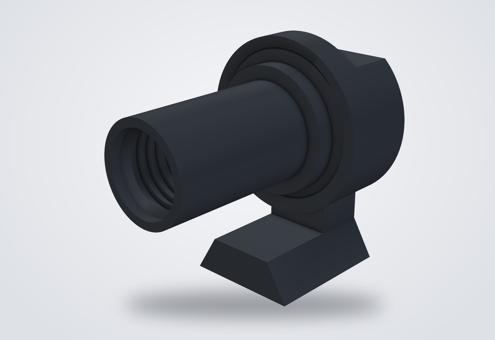
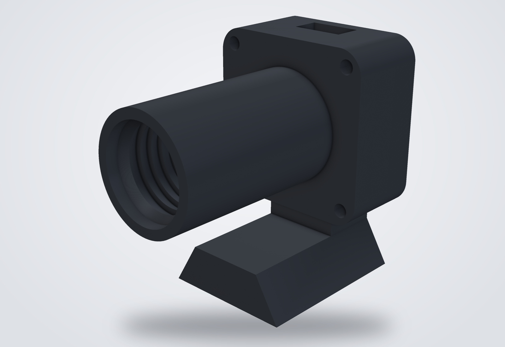

# 3D-Printable Parts

All parts are designed in [OpenSCAD](https://openscad.org/) for FDM printing. Source files are in [`hardware/3d_models/`](https://github.com/meridianfield/pushnav/tree/main/hardware/3d_models), with build instructions in its [README](https://github.com/meridianfield/pushnav/blob/main/hardware/3d_models/README.md).

For a new build, print the **[Camera Housing](#camera-housing-recommended)**. The older v2 and v1 housings are [deprecated](#deprecated-designs) but still available for existing builds.

---

## Camera Housing (recommended)

The camera sits in a threaded housing on a rotation mount that slides into a standard telescope finder shoe. The camera turns about its own axis, so its up/down and left/right line up with the telescope's even when the finder shoe sits at an angle: loosen the knob behind the mount, turn the camera until the app's mount axes look square with the screen, tighten, and recalibrate.

Everyone prints the [camera housing and hood](#camera-parts-every-setup). Then print the mount for your setup:

-   **With a laptop**

    ---

    

    The usual setup: the camera's USB cable goes straight to the computer running PushNav. Print the **low mount**.

    [:material-download: Low mount](https://github.com/meridianfield/pushnav/raw/main/hardware/3d_models/stls/housing_v3_mount.stl){ .md-button .md-button--primary }

-   **Standalone on a Raspberry Pi 3A+** (optional)

    ---

    

    Only if you run [PushNav headless on a Raspberry Pi](rpi-headless.md). A taller mount lifts the camera over a slim box that holds a Pi 3A+, making a self-contained unit. The box fits the **Pi 3A+ only**. [Details below](#pi-3a-mount-and-box-optional).

    [:material-download: Pi mount](https://github.com/meridianfield/pushnav/raw/main/hardware/3d_models/stls/housing_v4_mount.stl){ .md-button }
    [:material-download: Box base](https://github.com/meridianfield/pushnav/raw/main/hardware/3d_models/stls/housing_v4_box_base.stl){ .md-button }
    [:material-download: Box lid](https://github.com/meridianfield/pushnav/raw/main/hardware/3d_models/stls/housing_v4_box_lid.stl){ .md-button }

### Camera parts (every setup)

| Part | Description |
|------|-------------|
| **Camera housing** | Holds the camera; the hood screws into it, and its flat bottom clamps onto the mount's seat |
| **Hood** | Baffled lens shroud; its end takes the cap from the bottom of any 1.25" eyepiece barrel |
| **Dust cap** (optional) | Printed cap for the hood, if you have no spare eyepiece cap |

[:material-download: Camera housing](https://github.com/meridianfield/pushnav/raw/main/hardware/3d_models/stls/housing_v3_base.stl){ .md-button .md-button--primary }
[:material-download: Hood](https://github.com/meridianfield/pushnav/raw/main/hardware/3d_models/stls/housing_v3_hood.stl){ .md-button .md-button--primary }
[:material-download: Dust cap](https://github.com/meridianfield/pushnav/raw/main/hardware/3d_models/stls/housing_v3_cap.stl){ .md-button }

**Hardware:** one M4 × 20 star knob (Ø12.5 collar) and one M4 × 6 heat-set insert (5.8 mm knurl). The insert goes in the centre of the camera housing's bottom; the knob comes in from behind the mount and clamps the housing onto the seat. Both mounts use the same knob and insert.

!!! tip "Thread fit on your printer"
    The hood's thread is toleranced for typical FDM printers. If it binds or feels loose, change `lip_thread_tolerance` at the top of [`housing_v3.scad`](https://github.com/meridianfield/pushnav/blob/main/hardware/3d_models/housing_v3.scad) (0.6 mm by default; raise it for a looser fit) and reprint only the camera housing.

### Pi 3A+ mount and box (optional)

For running [PushNav headless](rpi-headless.md) on a **Raspberry Pi 3A+**, with the Pi carried on the telescope. With a laptop you don't need any of this — use the low mount above.

| Part | Description |
|------|-------------|
| **Pi mount** | Dovetail rail, a 15 mm riser (finger room for the shoe's thumbscrews under the box), a stem, and the same seat as the low mount |
| **Box base** | Holds the Pi 3A+ on pins; sits on the riser in front of the stem |
| **Box lid** | Snaps onto the base; pushers hold the Pi down; vent slots over the processor |

**Box layout**, standing behind the unit at the eyepiece:

- **USB-A** faces forward, under the camera — the one side that is clear on every telescope. Plug the camera's cable in with a straight plug, or one angled down or sideways; one that turns upward reaches into the camera's view.
- **Power** (micro-USB) is on the right. A right-angle plug keeps it within about 10 mm of the side.
- **Status LEDs** show through a window in the back wall, right of the stem. See [the status light](rpi-headless.md) for what they mean.
- **microSD card** is at the back, against the stem, with no slot — lift the lid to change it.

**Hardware**, on top of the camera's knob and insert: two M4 × 4 heat-set inserts (5.8 mm knurl) in the top of the riser, and two M4 × 6–10 pan or button head screws through the box floor into them — fit the screws before the Pi.

!!! tip "No inserts for the box?"
    Hot glue works instead of the riser's inserts and screws. Fill each pocket in the riser, set the box down, then top up through the holes in the box floor until the glue forms a low head (under 3 mm — the Pi sits just above it).

---

## Laser Pointer Holder

{ .render-sm }

Holds a 23 mm laser pointer on a standard finder shoe, for aligning the telescope by eye. The pointer sits in a V-groove cradle under a dovetail saddle, held with cable ties through slots in the cradle, and slides in from either end.

All hardware goes into brass heat-set inserts:

- **Dovetail clamp** — two M4 × 4 inserts in the saddle's side wall take 10–12 mm M4 clamp screws (nylon-tipped if you have them).
- **Tripod mount** — an 8 mm × 8 mm insert in the bottom (for example 1/4-20) mounts the holder on a photography quick-release plate instead.

Print it flat, without supports. Run a 5.4 mm drill through the two clamp bores before fitting their inserts — they print nearly horizontal and sag slightly at the top.

[:material-download: Laser pointer holder](https://github.com/meridianfield/pushnav/raw/main/hardware/3d_models/stls/laser_pointer_holder.stl){ .md-button .md-button--primary }

---

## Spare Camera Base

{ .render-sm }

Replacement for the white plastic base under the camera module's circuit board, in case the original breaks. It keeps the camera at the same height in the housing, touches the board only around its four mounting holes, and is fixed with hot glue instead of tiny screws: glue injected through each board hole sets as a hooked plug in the leg below, and releases with heat or isopropyl alcohol.

[:material-download: Camera base](https://github.com/meridianfield/pushnav/raw/main/hardware/3d_models/stls/camera_base.stl){ .md-button .md-button--primary }

---

## M12 Lock Ring

{ .render-sm }

Lock ring that secures the M12 lens at the correct focus position. Features a tapered centring collar and grip notches for finger tightening.

[:material-download: Lock ring](https://github.com/meridianfield/pushnav/raw/main/hardware/3d_models/stls/lock_ring.stl){ .md-button .md-button--primary }

---

## Print Settings

| Setting | Housing and accessories | Lock Ring |
|---------|-------------------------|-----------|
| Material | PLA or PETG | PLA or PETG |
| Layer height | 0.2 mm | 0.12 mm |
| Infill | 20% | 100% |
| Supports | Camera housing only (see below) | None |

!!! note "Camera housing supports"
    Every part prints without supports except the **camera housing**, which needs slicer supports in two places:

    - **USB cutout roof**: the top edge of the USB slot is an unsupported span.
    - **Upper edge of the chord-flat**: above the flat on its back, the cylinder returns to its full diameter and overhangs the flat below.

    Enable supports in your slicer (Cura, PrusaSlicer, OrcaSlicer, Bambu Studio) with "Supports on build plate only" or tree supports. Both regions are detected automatically.

!!! note
    Use opaque filament for the camera housing and hood so no stray light leaks through the walls. Print the lock ring at 100% infill and 0.12 mm layers for thread strength and a smooth finish.

---

## Deprecated Designs

!!! warning "Deprecated"
    These housings are kept for existing builds. New builds should use the [Camera Housing](#camera-housing-recommended).

-   **Camera Housing v2** (threaded)

    ---

    

    Threaded housing with the dovetail built into the base. The hood screws into the base by hand; a friction-fit cap covers the hood.

    :material-download: [base](https://github.com/meridianfield/pushnav/raw/main/hardware/3d_models/stls/housing_v2_base.stl) · [hood](https://github.com/meridianfield/pushnav/raw/main/hardware/3d_models/stls/housing_v2_hood.stl) · [cap](https://github.com/meridianfield/pushnav/raw/main/hardware/3d_models/stls/housing_v2_cap.stl)

-   **Camera Housing v1** (bolted)

    ---

    

    The original design: the hood bolts to the base with four M3 screws. The base has 2.7 mm holes for self-tapping screws or 3.5 mm holes for M3 bolts and nuts.

    :material-download: [base, self-tap](https://github.com/meridianfield/pushnav/raw/main/hardware/3d_models/stls/housing_base_selftap.stl) · [base, bolt-through](https://github.com/meridianfield/pushnav/raw/main/hardware/3d_models/stls/housing_base_bolt.stl) · [hood](https://github.com/meridianfield/pushnav/raw/main/hardware/3d_models/stls/housing_hood.stl) · [cap](https://github.com/meridianfield/pushnav/raw/main/hardware/3d_models/stls/housing_cap.stl)

---

## All Downloads

| File | Description |
|------|-------------|
| [`housing_v3_base.stl`](https://github.com/meridianfield/pushnav/raw/main/hardware/3d_models/stls/housing_v3_base.stl) | Camera housing |
| [`housing_v3_hood.stl`](https://github.com/meridianfield/pushnav/raw/main/hardware/3d_models/stls/housing_v3_hood.stl) | Hood |
| [`housing_v3_cap.stl`](https://github.com/meridianfield/pushnav/raw/main/hardware/3d_models/stls/housing_v3_cap.stl) | Dust cap (optional) |
| [`housing_v3_mount.stl`](https://github.com/meridianfield/pushnav/raw/main/hardware/3d_models/stls/housing_v3_mount.stl) | Low mount (with a laptop) |
| [`housing_v4_mount.stl`](https://github.com/meridianfield/pushnav/raw/main/hardware/3d_models/stls/housing_v4_mount.stl) | Pi mount (optional, Pi 3A+) |
| [`housing_v4_box_base.stl`](https://github.com/meridianfield/pushnav/raw/main/hardware/3d_models/stls/housing_v4_box_base.stl) | Pi 3A+ box base (optional) |
| [`housing_v4_box_lid.stl`](https://github.com/meridianfield/pushnav/raw/main/hardware/3d_models/stls/housing_v4_box_lid.stl) | Pi 3A+ box lid (optional) |
| [`laser_pointer_holder.stl`](https://github.com/meridianfield/pushnav/raw/main/hardware/3d_models/stls/laser_pointer_holder.stl) | Laser pointer holder |
| [`camera_base.stl`](https://github.com/meridianfield/pushnav/raw/main/hardware/3d_models/stls/camera_base.stl) | Spare camera base |
| [`lock_ring.stl`](https://github.com/meridianfield/pushnav/raw/main/hardware/3d_models/stls/lock_ring.stl) | M12 lock ring |
| [`housing_v2_base.stl`](https://github.com/meridianfield/pushnav/raw/main/hardware/3d_models/stls/housing_v2_base.stl) | v2 base (deprecated) |
| [`housing_v2_hood.stl`](https://github.com/meridianfield/pushnav/raw/main/hardware/3d_models/stls/housing_v2_hood.stl) | v2 hood (deprecated) |
| [`housing_v2_cap.stl`](https://github.com/meridianfield/pushnav/raw/main/hardware/3d_models/stls/housing_v2_cap.stl) | v2 cap (deprecated) |
| [`housing_base_selftap.stl`](https://github.com/meridianfield/pushnav/raw/main/hardware/3d_models/stls/housing_base_selftap.stl) | v1 base, self-tap holes (deprecated) |
| [`housing_base_bolt.stl`](https://github.com/meridianfield/pushnav/raw/main/hardware/3d_models/stls/housing_base_bolt.stl) | v1 base, bolt-through holes (deprecated) |
| [`housing_hood.stl`](https://github.com/meridianfield/pushnav/raw/main/hardware/3d_models/stls/housing_hood.stl) | v1 hood (deprecated) |
| [`housing_cap.stl`](https://github.com/meridianfield/pushnav/raw/main/hardware/3d_models/stls/housing_cap.stl) | v1 cap (deprecated) |
