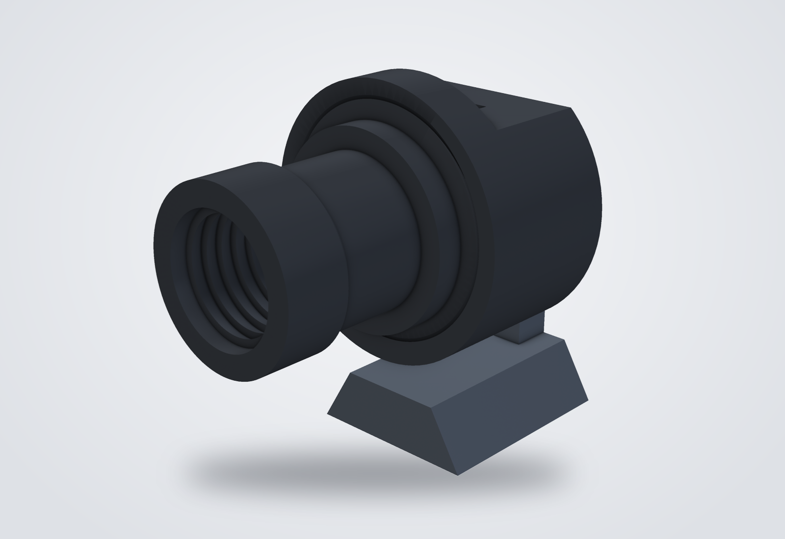
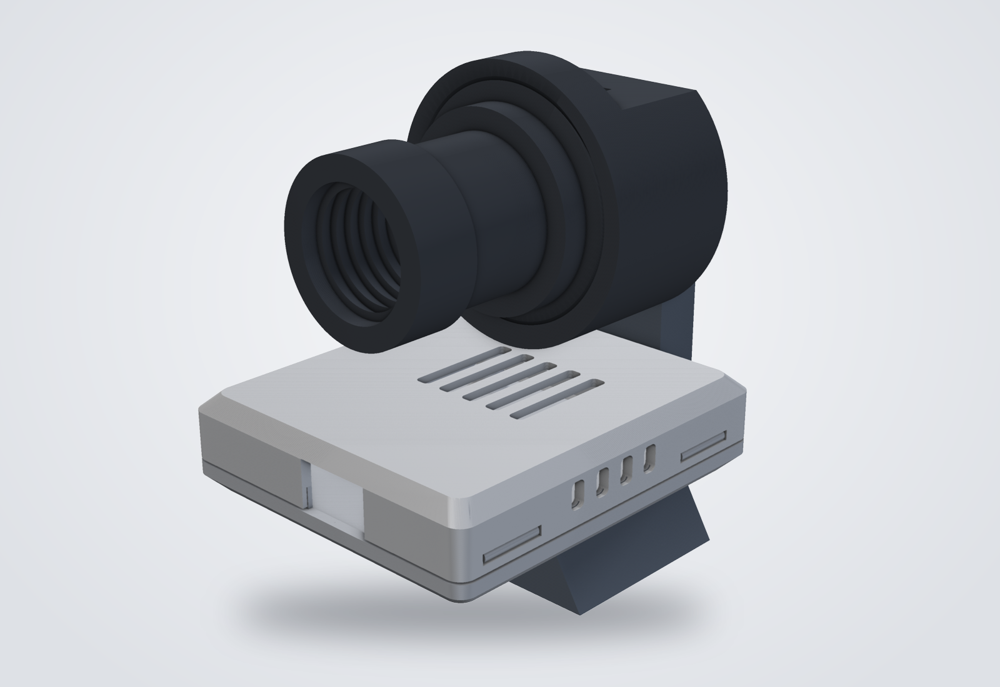
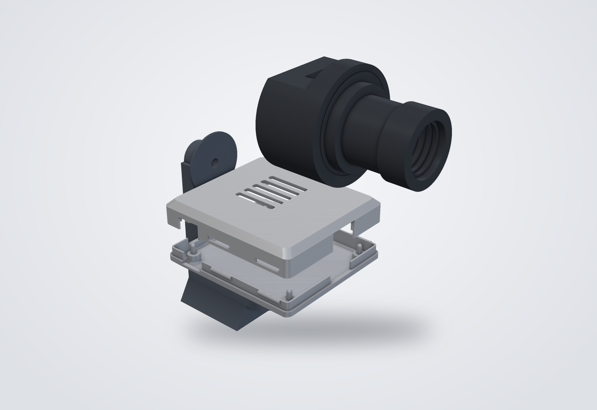
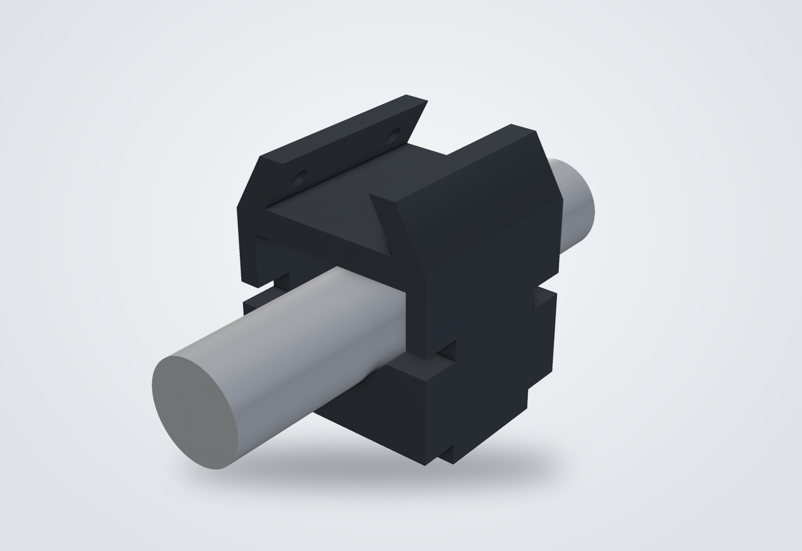
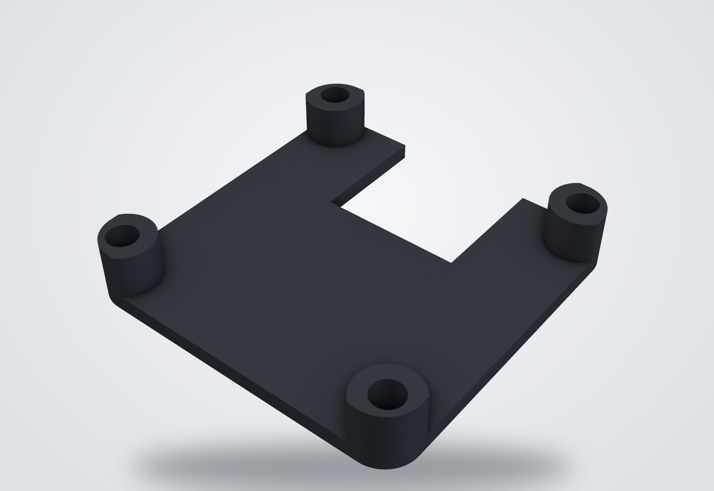
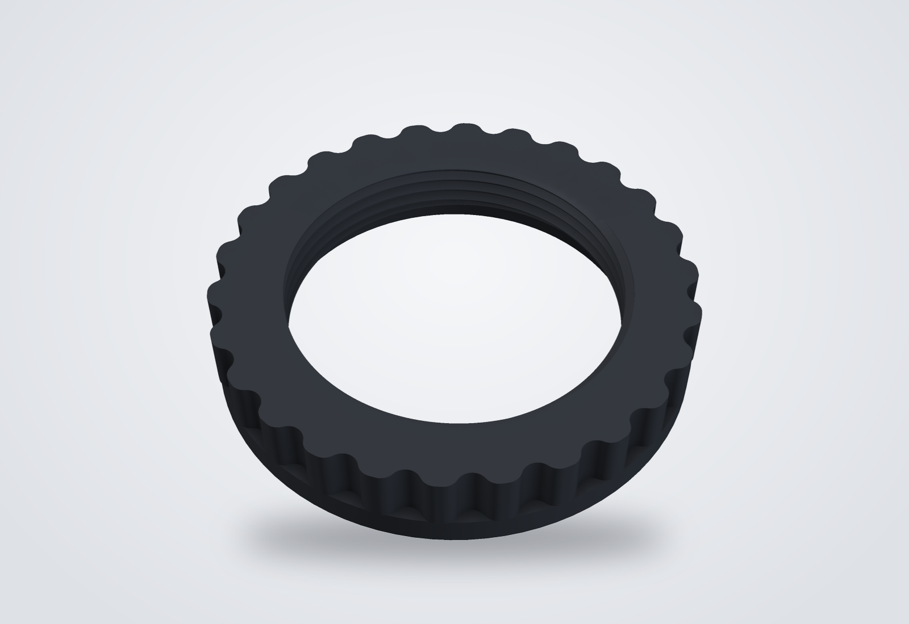

# PushNav 3D Models

3D-printable parts for PushNav. All models are written in [OpenSCAD](https://openscad.org/) for FDM printing, and ready-to-print STLs are in [`stls/`](stls/).

<p>
  
  
</p>

## Parts

- **[Camera Housing](#camera-housing--recommended)** (recommended): the camera on a rotation mount, on the low mount for use with a laptop or — optionally — over a box for a Raspberry Pi 3A+
- **[Laser Pointer Holder](#laser-pointer-holder-laser_pointer_holderscad)**: puts a 23 mm laser pointer on a finder shoe
- **[Camera Base](#camera-base-camera_basescad--spare-part)**: spare for the camera module's white base
- **[M12 Lock Ring](#m12-lock-ring-lock_ringstl)**: holds the lens at focus
- **[Deprecated housings](#deprecated-designs)**: v2 and v1, kept for existing builds

### Camera Housing — recommended

The camera sits in a threaded housing on a rotation mount that slides into a standard telescope finder shoe. The camera turns about its own axis, so its up/down and left/right line up with the telescope's even when the finder shoe sits at an angle: loosen the knob behind the mount, turn the camera until the app's mount axes look square with the screen, tighten, and recalibrate.

Everyone prints the camera housing and hood. Then print the mount for your setup:

| Setup | Print |
|-------|-------|
| **With a laptop** — the camera's USB cable goes straight to the computer | Camera housing, hood, **low mount** (`housing_v3.scad`) |
| **Standalone on a Raspberry Pi 3A+** (optional) — for [PushNav headless](../../docs/rpi-headless.md), with the Pi carried on the telescope | Camera housing, hood, **Pi mount, box base and box lid** (`housing_v4.scad`) |

The dust cap is optional in both.

#### Camera parts and low mount (`housing_v3.scad`)

| Part | STL | Flag | Description |
|------|-----|------|-------------|
| Camera housing | `housing_v3_base.stl` | `RENDER_BASE` | 50 mm shell with the camera pocket and a 44 mm female thread; its flat bottom turns on the mount's seat and holds the knob's insert |
| Hood | `housing_v3_hood.stl` | `RENDER_HOOD` | Screws into the housing; 30 mm baffled shroud ending in a 31.7 mm band that takes a standard 1.25" eyepiece barrel cap |
| Dust cap (optional) | `housing_v3_cap.stl` | `RENDER_CAP` | Printed slip-on cap for the band, if you have no spare eyepiece cap |
| Low mount | `housing_v3_mount.stl` | `RENDER_MOUNT` | Finder-shoe dovetail, a low bridge rib, and the flat Ø30 seat the camera turns on |

**Hardware:** one M4 × 20 star knob (Ø12.5 collar) from behind the mount into one M4 × 6 heat-set insert (5.9 mm knurl) in the centre of the housing's bottom. Tightening it clamps the housing onto the seat. The insert pocket has a 45° lead-in and a narrower relief that catches displaced plastic and stops the insert flush. The Pi mount uses the same knob and insert.

**Thread fit:** the housing's female thread uses `lip_thread_tolerance = 0.6` mm and the hood's male thread `hood_thread_tolerance = 0.4` mm. If the hood binds, raise `lip_thread_tolerance` to 0.7; if it's sloppy, drop it to 0.5 — only the housing needs reprinting.

**Cap:** use the cap from the bottom of any 1.25" eyepiece (or Barlow / diagonal) barrel — the caps for the eye-lens end vary in size and won't fit.

**Printing** (a single part exports in its print orientation): low mount back face down, hood lip-thread end down, cap closed top down — all without supports. The camera housing prints bottom face down (it is the clamping face, so it comes out flat) and needs supports in two spots (see [Print Settings](#print-settings)).

The threads come from Ryan Colyer's [`threads.scad`](vendor/threads.scad) (CC0).

#### Pi 3A+ mount and box (`housing_v4.scad`) — optional

Only for running PushNav headless on a **Raspberry Pi 3A+**; the box is sized for the 3A+ and no other model. A taller mount lifts the camera over a slim box for the Pi, so the camera, Pi and mount make one self-contained unit. With a laptop, use the low mount instead.



| Part | STL | Flag | Description |
|------|-----|------|-------------|
| Pi mount | `housing_v4_mount.stl` | `RENDER_MOUNT` | Finder-shoe dovetail with a 15 mm riser (finger room for the shoe's thumbscrews under the box), a 20 × 10 mm stem, and the same Ø30 seat as the low mount |
| Box base | `housing_v4_box_base.stl` | `RENDER_BOX_BASE` | Holds the Pi on pins; sits on the riser, 2 mm in front of the stem |
| Box lid | `housing_v4_box_lid.stl` | `RENDER_BOX_LID` | Snaps onto the base; pushers hold the Pi down; vent slots over the SoC |

`housing_v4.scad` pulls in the camera housing and hood from `housing_v3.scad` for its preview only; turn `SHOW_CAMERA` off for faster previews.

**Board layout** (standing behind the unit): USB-A faces forward, under the camera — the one side that is clear on every scope. Power is on the right (a right-angle micro-USB plug keeps it within ~10 mm of the side). The status LEDs show through a window in the back wall, right of the stem. The microSD card is at the back with no slot — lift the lid to change it.

**Hardware**, on top of the camera's knob and insert: 2 × M4 × 4 heat-set inserts in the riser's top and 2 × M4 × 6–10 pan or button head screws from inside the box, fitted before the Pi (socket heads are too tall to clear the board). Without inserts, hot glue works too: fill each riser pocket, set the box down, and top up through the floor holes until a low head (under 3 mm) forms inside the box.

**Printing:** mount back face down, box base floor down, lid top down — no supports.

The box is generated with [YAPP_Box](https://github.com/mrWheel/YAPP_Box) (MIT, vendored under [`vendor/YAPP_Box/`](vendor/YAPP_Box/)).

### Laser Pointer Holder (`laser_pointer_holder.scad`)



V-groove cradle for a 23 mm laser pointer under a dovetail saddle that slides onto a standard telescope finder shoe. The saddle design is derived from [rziomber's Vixen-style dovetail](https://www.thingiverse.com/thing:4853379), adapted to the finder shoe profile used by the camera housing. Two bridging side walls leave the front and back of the cradle open: the laser pointer slides in from either end and is held with cable ties through slots in the V-block.

All hardware goes into brass heat-set inserts, installed with a soldering iron after printing:

- **Dovetail clamp** — two M4 inserts (5.8 mm OD × 4 mm) in the saddle's sloped side wall; M4 matches commercial finder-shoe clamp screws. Both outer flanks are cut parallel to the dovetail channel walls (uniform 6 mm thickness), so the inserts seat flush and the clamp screws press square onto the rail. Use 10–12 mm M4 screws, nylon-tipped if available. Go gently on these two — the bore sits ~1.8 mm from the saddle's top edge.
- **Tripod mount** — a 7.8 mm × 8.5 mm bore in the bottom face takes an 8 mm OD × 8 mm insert (e.g. 1/4-20 for a photography quick-release plate), as an alternative to the finder shoe.

**Printing:** flat (Z = 0 face on the bed), no supports. Run a 5.4 mm drill through the two clamp bores before heat-setting — they print near-horizontal and sag slightly at the ceiling.

### Camera Base (`camera_base.scad`) — spare part



Replacement for the white plastic base that ships under the 25 mm camera module's PCB, in case it breaks. Same 25 × 25 × 4.5 mm envelope, so the camera sits at the same height in the housing.

- **Four corner legs** support the PCB only on the bare 4.5 mm area around each mounting hole (21.3 mm spacing), keeping clear of the components on the underside.
- **Hot glue instead of screws** — a 2.2 mm channel runs from each PCB hole down through its leg and the floor into a recess on the underside. The glue sets as a hooked plug, so it holds even though hot glue bonds poorly to printed plastic, and it releases with heat or isopropyl alcohol.
- **USB-C cutout** — full-height notch centred on one edge for the socket on the PCB underside.

**Assembly:** place the base on baking paper, set the PCB on top with the holes aligned, and inject hot glue into each PCB hole until it leaves a small head on top. Once cool, peel off the paper and trim any glue standing proud of the underside.

**Printing:** floor down, no supports. PETG preferred; with PLA, use a low-temperature glue gun so the thin legs don't soften.

### M12 Lock Ring (`lock_ring.stl`)



Lock ring that secures the M12 lens at the correct focus position. Features a tapered centring collar and grip notches for finger tightening.

## Deprecated designs

Kept for existing builds. New builds should use the [Camera Housing](#camera-housing--recommended).

### Camera Housing v2 (`housing_v2.scad`) — deprecated

Threaded housing with the dovetail built into the base: a 50 mm shell with a 44 mm female thread that the hood screws into by hand, and a friction-fit dust cap. Parts: `housing_v2_base.stl`, `housing_v2_hood.stl`, `housing_v2_cap.stl`.

### Camera Housing v1 (`housing.scad`) — deprecated

The original bolted housing: a base with an integrated dovetail, a hood bolted on with four M3 screws, and a friction-fit cap. The base comes in two variants set by `SELF_TAP_SCREWS` — 2.7 mm holes for self-tapping screws (`housing_base_selftap.stl`) or 3.5 mm holes for M3 bolts and nuts (`housing_base_bolt.stl`). Hood and cap: `housing_hood.stl`, `housing_cap.stl`.

## Pre-built STLs

All in [`stls/`](stls/).

| File | Part |
|------|------|
| **Camera Housing** | |
| `housing_v3_base.stl`     | Camera housing, flat clamping bottom |
| `housing_v3_hood.stl`     | Hood with 1.25" cap band |
| `housing_v3_cap.stl`      | Fallback slip-on cap (optional) |
| `housing_v3_mount.stl`    | Low mount (with a laptop) |
| `housing_v4_mount.stl`    | Pi mount: dovetail, riser, stem and seat (optional, Pi 3A+) |
| `housing_v4_box_base.stl` | Pi 3A+ box base (optional) |
| `housing_v4_box_lid.stl`  | Pi 3A+ box lid (optional) |
| **Accessories** | |
| `laser_pointer_holder.stl` | Laser Pointer Holder |
| `camera_base.stl`          | Spare camera base (replaces the module's white base) |
| `lock_ring.stl`            | M12 Lock Ring |
| **Deprecated** | |
| `housing_v2_base.stl`      | v2 base + thread + dovetail |
| `housing_v2_hood.stl`      | v2 hood + male thread + baffle |
| `housing_v2_cap.stl`       | v2 dust cap |
| `housing_base_selftap.stl` | v1 base (2.7 mm self-tap holes) |
| `housing_base_bolt.stl`    | v1 base (3.5 mm bolt-through holes) |
| `housing_hood.stl`         | v1 hood + baffle |
| `housing_cap.stl`          | v1 dust cap |

## Print Settings

| Setting | Housings and accessories | Lock Ring |
|---------|--------------------------|-----------|
| Layer height | 0.2 mm | 0.12 mm |
| Perimeters | 3 | 3 |
| Infill | 20% | 100% |
| Supports | Camera housing only (see below) | None |

Use opaque filament for the camera housing and hood so no stray light leaks through the walls.

**Camera housing supports.** Everything else is support-free, but the camera housing (`housing_v3_base.stl`, and the deprecated v1 and v2 bases) needs slicer supports in two places:

- **USB cutout roof** — the top edge of the USB slot is an unsupported span.
- **Upper edge of the chord-flat** (v2 and v3 shells) — above `back_flat_y`, the back of the cylinder returns to its full diameter and overhangs the chord-flat below.

Most slicers (Cura, PrusaSlicer, OrcaSlicer, Bambu Studio) place these automatically with "Supports on build plate only" or tree supports; custom support blockers aren't needed.

## Building STLs from Source

Requires [OpenSCAD](https://openscad.org/) (command line or GUI). In the GUI, set one part's `RENDER_*` flag to `true` and the others to `false`, Render (F6), and export as STL. From the command line:

```bash
# Pi 3A+ mount and box (optional) — each part alone is placed in its print orientation
for part in MOUNT BOX_BASE BOX_LID; do
  args=""
  for p in MOUNT BOX_BASE BOX_LID; do
    [ "$p" = "$part" ] && v=true || v=false
    args="$args -D RENDER_$p=$v"
  done
  openscad -o "stls/housing_v4_$(echo $part | tr A-Z a-z).stl" $args housing_v4.scad
done

# Camera housing, hood, cap and low mount
for part in MOUNT BASE HOOD CAP; do
  args=""
  for p in MOUNT BASE HOOD CAP; do
    [ "$p" = "$part" ] && v=true || v=false
    args="$args -D RENDER_$p=$v"
  done
  openscad -o "stls/housing_v3_$(echo $part | tr A-Z a-z).stl" $args housing_v3.scad
done

# Accessories
openscad -o stls/laser_pointer_holder.stl laser_pointer_holder.scad
openscad -o stls/camera_base.stl camera_base.scad
```

<details>
<summary>Deprecated housings (v2, v1)</summary>

```bash
# v2
openscad -o stls/housing_v2_base.stl \
  -D 'RENDER_BASE=true' -D 'RENDER_HOOD=false' -D 'RENDER_CAP=false' housing_v2.scad
openscad -o stls/housing_v2_hood.stl \
  -D 'RENDER_BASE=false' -D 'RENDER_HOOD=true' -D 'RENDER_CAP=false' housing_v2.scad
openscad -o stls/housing_v2_cap.stl \
  -D 'RENDER_BASE=false' -D 'RENDER_HOOD=false' -D 'RENDER_CAP=true' housing_v2.scad

# v1 — base, self-tapping and bolt-through variants
openscad -o stls/housing_base_selftap.stl \
  -D 'RENDER_BASE=true' -D 'RENDER_HOOD=false' -D 'RENDER_CAP=false' \
  -D 'SELF_TAP_SCREWS=true' housing.scad
openscad -o stls/housing_base_bolt.stl \
  -D 'RENDER_BASE=true' -D 'RENDER_HOOD=false' -D 'RENDER_CAP=false' \
  -D 'SELF_TAP_SCREWS=false' housing.scad

# v1 — hood and cap
openscad -o stls/housing_hood.stl \
  -D 'RENDER_BASE=false' -D 'RENDER_HOOD=true' -D 'RENDER_CAP=false' housing.scad
openscad -o stls/housing_cap.stl \
  -D 'RENDER_BASE=false' -D 'RENDER_HOOD=false' -D 'RENDER_CAP=true' housing.scad
```

</details>

## Website images

The renders on this page and on the [3D Models](https://meridianfield.github.io/pushnav/3d-models/) site page are made from the STLs by [`scripts/render_3d_models.py`](../../scripts/render_3d_models.py). After changing a design, re-export its STLs, then run `uv run scripts/render_3d_models.py` from the repo root.
